## 写在前面

入手用了一阵，觉得原厂的腾讯桌面不太合我的使用习惯，我更想要一个简洁、能自己排布的桌面。另外有几个预装应用我用不到，设置里没找到卸载入口，要用电脑连 ADB 才能处理。所以我干脆想换掉整个桌面，结果又卡在两道坑上：ADB 藏在工程菜单最里层，好不容易打开，关一次机又被系统恢复成关；第三方桌面装是装上了，可不给它开无障碍权限就不顶用——按 Home 还是跳回腾讯桌面，而那个「去设置」按钮在这台机上根本点不进去。前后摸索了好几天才把这几步理顺，干脆写下来给同款机器的朋友省点事。

我用的机器是**小明 Q5 Pro（XMM3101），极光 TV 版，Android 13，固件 2.0.7.1070**。下面全是这台机器在 2026 年 10 月的实测，其他型号或固件可能菜单位置不一样。

先说清楚风险：这些操作都不需要 root，也不会刷机，不想用了卸载就能恢复。但工程菜单里别的选项（复位、校准、老化测试）千万别乱点。

顺序就是我当时踩坑的顺序：先进工程菜单把 ADB 打开，再用电脑连上去，然后装个小工具让 ADB 开机自己恢复，最后解决无障碍设置进不去的问题。文末列了几个我在这台机器上实际用过的软件；其中开机恢复和无障碍跳转这两个小工具是我自己做的。

## 为什么非得折腾 ADB 和无障碍

ADB 可以理解成电脑远程控制投影仪的一条通道。装软件其实用不着它，沙发管家、U 盘都行。但有些权限投影仪上没有开关可点，只能在电脑上输一行命令给过去。

无障碍权限则是很多桌面和按键工具的命门。想让遥控器按 Home 回到新桌面，而不是跳回腾讯桌面，就得靠它监听按键。

Q5 Pro 的麻烦在于，这两样东西的入口都藏得很深。普通设置里没有开发者选项，系统里也没有 Android 原生的设置应用，网上其他机型的组合键在这台上也不管用。

## 准备工作

- 一台电脑，Windows 或 Mac 都行，和投影仪连同一个 Wi-Fi
- 遥控器
- 电脑上的 ADB 工具包：去 [Android 官方页面](https://developer.android.com/tools/releases/platform-tools) 下载 SDK Platform-Tools，选自己系统的版本，解压就行，不用安装
- 文中用到的几个 APK，下载地址我放在对应的步骤里

## 第一步：从工程菜单打开 ADB

入口藏在「用户协议」那一项上。我是把系统设置的 APK 导出来翻代码才发现的：焦点停在这一项上时，连按 7 次方向上键就会弹出工程菜单。

1. 打开「系统设置」
2. 进右下角的「系统信息」
3. 打开「关于本机」，往下找到「法律信息」
4. 把焦点移到「用户协议」上，**别点进去**，直接按 7 次遥控器上键
5. 弹出工程菜单后，往下找「调试诊断」
6. 把「ADB ENABLE」调成「开」

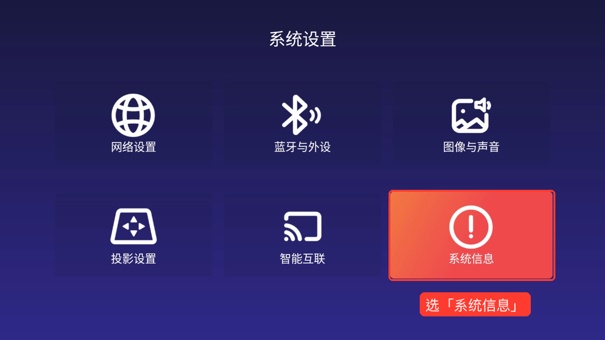

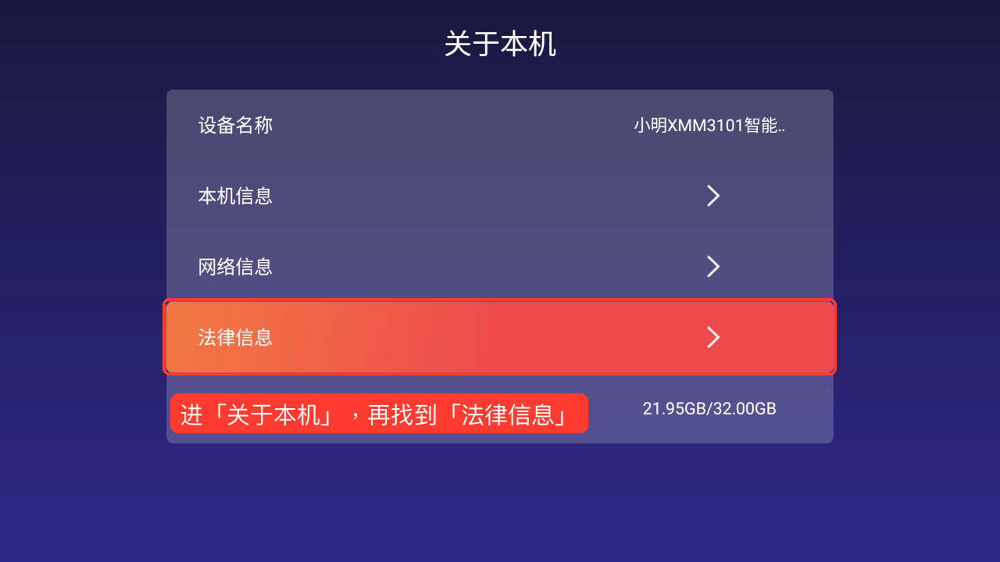

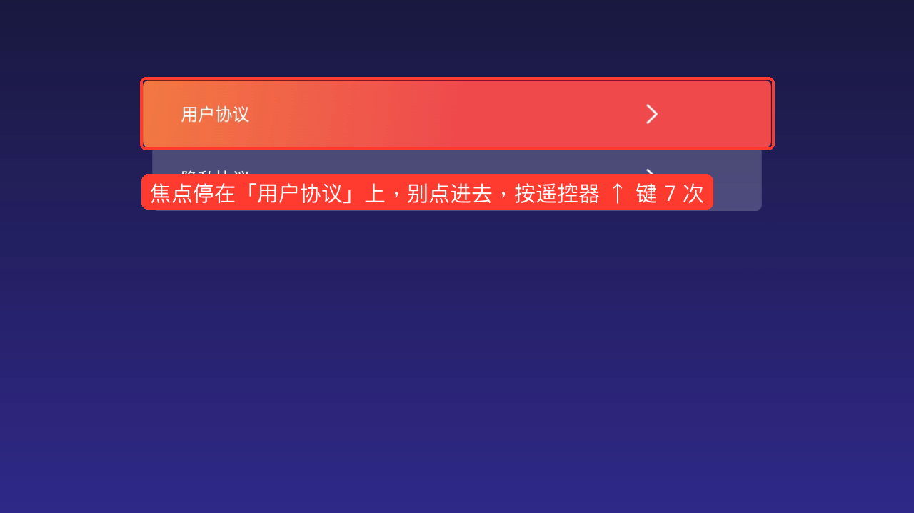

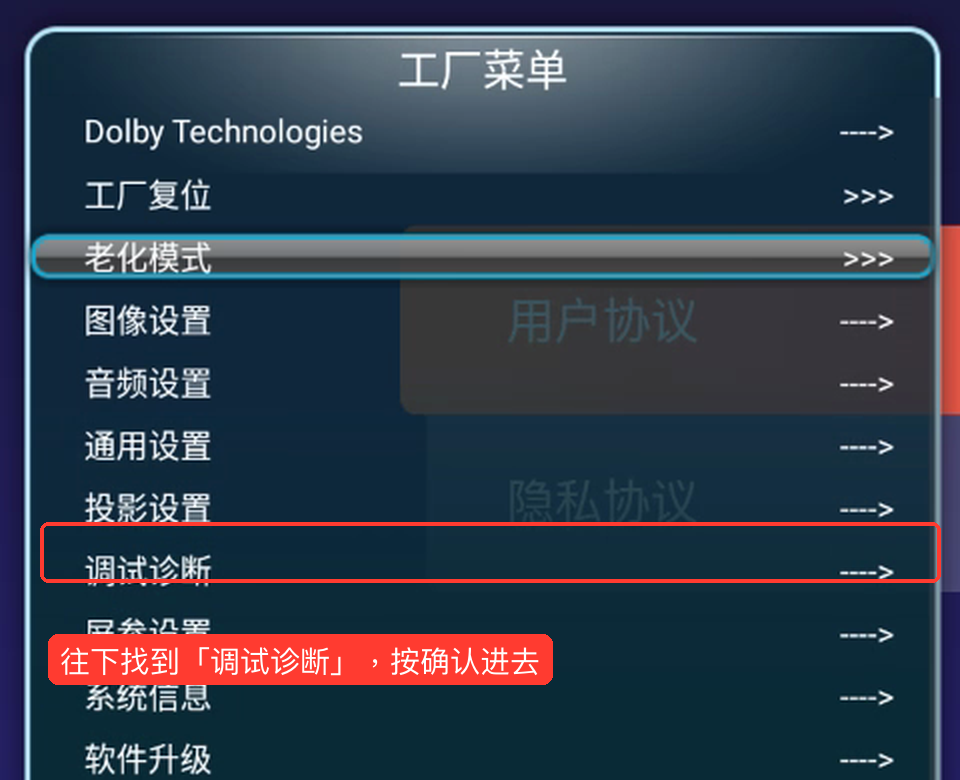

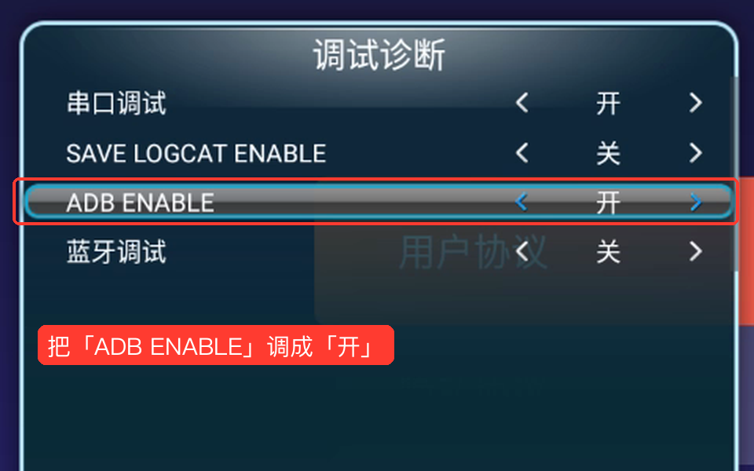

两个坑：第 4 步焦点一离开「用户协议」，计数就清零了，按漏了重新按 7 次就行。另外工程菜单里的复位、初始化、校准都别碰，系统里那个叫 CvteAT 的应用也别打开。我试过一次，黑屏退不出来，音量还被拉到了最大。

## 第二步：电脑连上投影仪

**先记下投影仪的 IP。** 在投影仪的网络设置里点开当前连的 Wi-Fi，能看到一串类似 192.168.1.100 的地址。

**在工具包文件夹里打开终端。** 解压后会有一个 platform-tools 文件夹：

- Windows：在文件夹空白处右键，选「在终端中打开」。没有这一项的话，在文件夹地址栏输入 powershell 再回车。
- Mac：打开「终端」，输入 cd 加一个空格，把 platform-tools 文件夹拖进窗口，回车。

**连接。** 把下面的 IP 换成你自己的，后面的 :5555 留着：

```sh
./adb connect 192.168.1.100:5555
./adb devices
```

第二条命令会列出已连接的设备，地址后面写着 `device` 就是连上了。

连上的话，终端里大概是这样：

```text
connected to 192.168.1.100:5555
List of devices attached
192.168.1.100:5555    device
```

连不上的话先看报错：

| 看到的报错 | 怎么办 |
| --- | --- |
| Connection refused | 投影仪的 ADB 没开，或者刚重启过被关掉了，回工程菜单再开一次 |
| 超时 / 网络不可达 | IP 写错了，或者电脑和投影仪不在同一个网络 |
| unauthorized | 去投影仪屏幕上点允许 |

如果电脑上还连了手机或模拟器，后面的命令可能会报「more than one device」。先断开其他设备，或者在 adb 后面加上 `-s 192.168.1.100:5555` 指定投影仪。

## 第三步：让 ADB 开机自己打开

连上之后我高兴了没多久，关机再开，又连不上了。

查了一下厂商的服务代码，它每次开机都会把 ADB 重新设成默认值，而这台机器的默认值就是关。也就是说，工程菜单里开一次只管这一次开机。

每次都进工程菜单按 7 次上键太烦了，所以我写了个小软件「ADB 开机恢复」：开机完成后把 ADB 开关重新打开，再在大约 30、90、180 秒后各检查一遍。它没有常驻后台，只改这一个开关。

下载：[q5-adb-restore.apk](/downloads/q5/q5-adb-restore.apk)（源码在[工具合集包](/downloads/q5/q5-tools-with-source.zip)里，校验值见 [SHA256SUMS.txt](/downloads/q5/SHA256SUMS.txt)）

**1. 安装**

用你习惯的方法装就行，沙发管家的远程安装、U 盘都可以。电脑已经连着的话，也可以直接：

```sh
./adb install q5-adb-restore.apk
```

**2. 给权限（关键一步）**

装好还不能用。修改 ADB 开关需要一个叫 WRITE\_SECURE\_SETTINGS 的权限，投影仪上没有地方能点，只能用电脑给。整行复制进去，回车：

```sh
./adb shell pm grant local.q5.adbrestore android.permission.WRITE_SECURE_SETTINGS
```

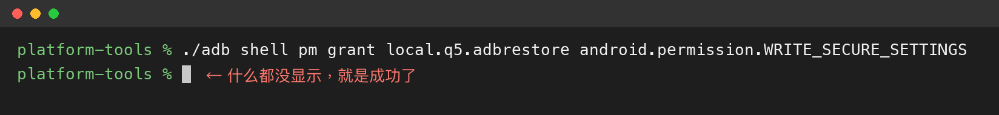

成功的话什么都不会显示，直接回到输入提示符。报 `Unknown package` 就是软件没装上。这一步每台机器只用做一次。

**3. 启用**

在应用列表里打开「ADB 开机恢复」，或者用命令：

```sh
./adb shell am start -n local.q5.adbrestore/.MainActivity
```

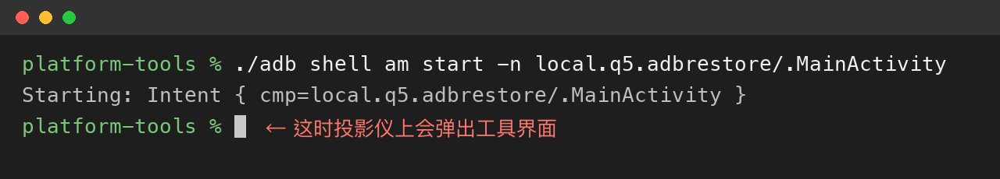

点「启用开机恢复并立即恢复 ADB」，上面变成「自动恢复：已启用」就好了。只装不点的话不会生效。

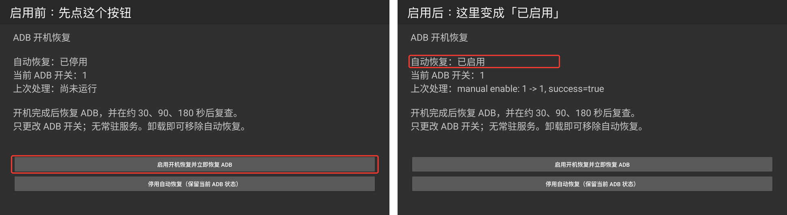

我测了一次完整的关机再开：刚开机的那几秒连接会被拒绝，等一会儿就自己恢复了，没再进工程菜单。拔电源重启和长期使用还没专门测，大家用了可以反馈一下。

不想用了就点「停用自动恢复」，或者直接卸载。停用不会马上关掉当前的 ADB，要关还得回工程菜单。

## 第四步：打开无障碍设置

这是我卡得最久的地方。

装好 Projectivy Launcher 后，它会让你开无障碍权限，还贴心地给了个「显示无障碍服务设置」的按钮。可在 Q5 Pro 上一点，什么都没发生。系统设置里我也翻了一圈，没找到无障碍。

原因是：普通安卓软件都用系统标准的方式跳转无障碍页面，而这台机器的无障碍页面是 CVTE 自己做的，标准入口没有指向它。页面其实还在，只是换了个门。

下面三个办法，选一个就行。

### 办法一：用命令打开 CVTE 的无障碍页面

什么都不用装，电脑连着就能用：

```sh
./adb shell am start -a com.cvte.intent.action.ACCESSIBILITY_SETTING
```

投影仪上会直接弹出原厂的无障碍窗口，在列表里找到要开的软件，打开就行。缺点是每次要开都得连电脑。

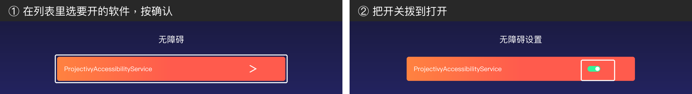

### 办法二：装一个 TV Settings

想用遥控器就能打开，可以装 [TvSettingsOnFire](https://github.com/ewlsh/TvSettingsOnFire/releases/tag/v0.1)。它是把旧版 Android TV 设置移植过来的，原本给 Fire TV 用，在 Q5 Pro 上能打开无障碍、声音、显示、日期时间和开发者选项这几页。

下载发布页里的 app-release.apk，装好后同样要用电脑给权限，否则里面的开关拨不动：

```sh
./adb shell pm grant com.rockon999.android.tv.settings android.permission.WRITE_SECURE_SETTINGS
./adb shell pm grant com.rockon999.android.tv.settings android.permission.DUMP
```

之后在应用列表里打开它（电脑连着的话也可以用 `./adb shell am start -n com.rockon999.android.tv.settings/.MainSettings` 直接打开）。首页往下移到「偏好设置」，一直往右找到「辅助功能」，再进「服务」，选中要开的软件，把「状态」打开。

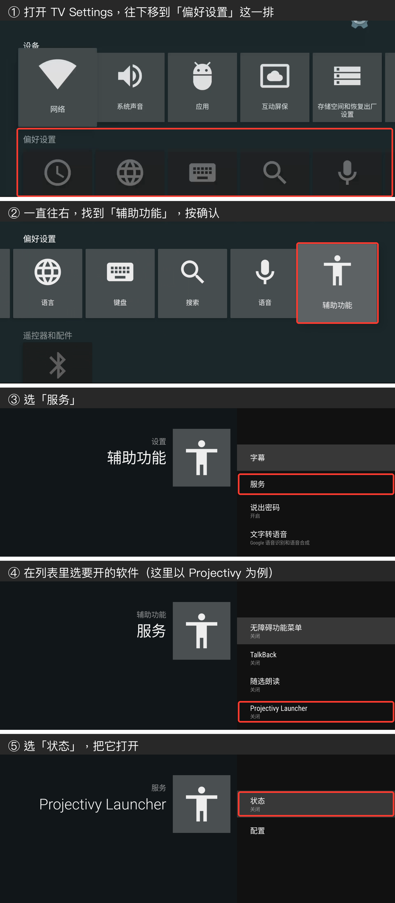

它毕竟是旧版移植：「语言」会闪退，「应用管理」打不开。另外装了它以后，有些软件里的「系统设置」按钮可能会跳到它而不是原厂设置，原厂设置从桌面进不受影响。

### 办法三：装我做的跳转小工具

如果只是想让 Projectivy 那个按钮能点进去，我还做了个「无障碍设置入口」：装上以后，Projectivy 的「显示无障碍服务设置」就能跳到 CVTE 的那个窗口，桌面上也会多一个同名图标。它不申请权限，也没有后台，只负责跳转，装好就能用，不用连电脑给权限。

下载：[q5-accessibility-bridge.apk](/downloads/q5/q5-accessibility-bridge.apk)


图里其他开关是我自己的设置，不用照着开。

不管用哪个办法，只开你需要的那一个服务就好，列表里的其他服务不用全开。

## 弄好之后可以玩点什么

ADB 和无障碍都通了，就可以开始换桌面了。下面是我在 Q5 Pro 上实际装过的：

| 软件 | 用来干什么 | 需要的权限 | 我的使用情况 |
| --- | --- | --- | --- |
| [Emotn UI](https://app.emotn.com/ui/) | 第三方桌面，界面干净 | 无 | 现在天天在用 |
| [Launcher Hijack](https://github.com/BaronKiko/LauncherHijack/releases/tag/403) | 按 Home 时打开你选的桌面，而不是腾讯桌面 | 无障碍 | 和 Emotn UI 搭配，按 Home 能回到 Emotn |
| Projectivy Launcher | 另一个第三方桌面，自定义项很多 | 无障碍 | 能用，无障碍跳转用上面办法三解决 |
| Button Mapper | 改遥控器按键功能 | 无障碍 | 试过，单用它接管 Home 会回到腾讯桌面，我后来停了 |
| [TvSettingsOnFire](https://github.com/ewlsh/TvSettingsOnFire/releases/tag/v0.1) | 补一套 TV 风格设置，含开发者选项 | WRITE\_SECURE\_SETTINGS、DUMP | 前面办法二用的就是它 |

我自己最后留下的是 **Emotn UI + Launcher Hijack**。两个会抢 Home 键的工具别同时开，会打架。另外原厂桌面并没有卸掉，只是按 Home 时被接管了，不想用了关掉无障碍服务就恢复。

换完之后大概是这样。开机和按 Home 都是这个桌面，常用的应用可以自己加到首页：

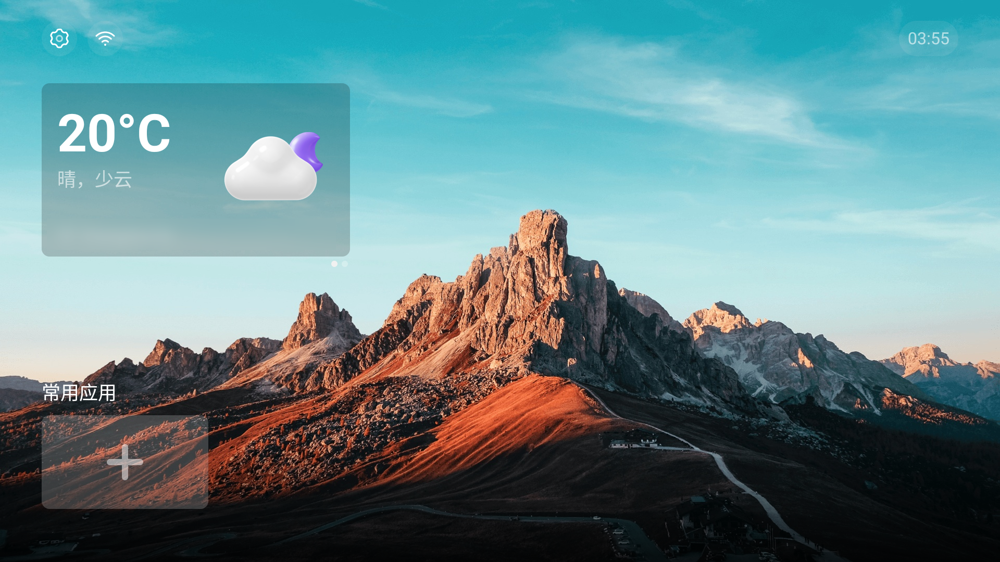

应用列表里能看到前面装的几个工具：Projectivy、无障碍设置入口、Launcher Hijack、ADB 开机恢复。

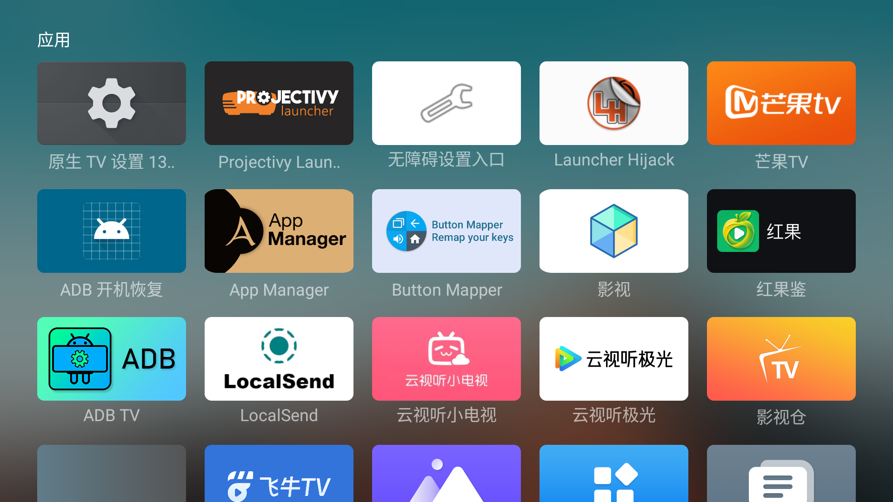

具体怎么换桌面、怎么配 Launcher Hijack，推荐看 @杨葛格 的这篇[《将 FengOS 系统默认桌面更换为第三方桌面启动器》](https://zhuanlan.zhihu.com/p/19270170689)，我之前也是参考它来配的。作者主页里还有别的投影仪相关文章，感兴趣可以去翻翻。

要注意的是，那篇文章写的是 FengOS，里面也说了 Q5 Pro 这类极光 TV 机型不适用。所以前面打开 ADB 和无障碍这部分按我这篇做，后面配桌面的思路是通用的。

想顺便清理一下用不到的预装应用，可以装个 ADB TV。它是个应用管理工具，能卸载或停用设置里删不掉的系统应用，前面应用列表的截图里也能看到我装了它。安装和用法可以直接照着杨葛格的视频[《通过 ADB TV 卸载小明、峰米投影预装应用》](https://www.bilibili.com/video/BV11zQbY8Exa/)来，讲得很清楚。

同样要注意：视频是按 FengOS 做的，里面给的可卸载清单不一定适用 Q5 Pro。卸之前先搞清楚这个应用是干啥的，不确定就先「停用」而不是卸载。桌面、设置、输入法和带 cvte 字样的系统组件别动，删错了可能开不了机。

## 常见问题

**开机以后还是连不上？** 先等一两分钟，工具要等系统开机完成才会动。还不行就看看 IP 是不是变了，路由器重启后经常会变。工具只管 ADB 开关，不管 IP。

**按 Home 又回到腾讯桌面？** 检查 Launcher Hijack 的无障碍服务还开着没有，再看有没有别的工具在抢 Home 键。

**ADB 一直开着安全吗？** 在自己家里的网络用问题不大。但我在日志里看到这台机器的网络 ADB 可能不强制确认连接，所以别把 5555 端口映射到公网，也别在公共 Wi-Fi 下开着。

**想全部恢复原样？** 装了哪个卸哪个，不用恢复出厂。按需挑一条执行：

```sh
./adb uninstall local.q5.adbrestore
./adb uninstall local.q5.accessibilitybridge
./adb uninstall com.rockon999.android.tv.settings
./adb uninstall com.baronkiko.launcherhijack
```

卸载不会自动关掉之前开过的无障碍服务和 ADB，需要的话分别去无障碍页面和工程菜单里关。

## 最后

这些都是我这一台机器上试出来的，固件不一样可能会有差别。如果你的菜单位置不同，或者开机恢复工具在你那里不管用，欢迎到 [GitHub Issues](https://github.com/luoxu1314/luoxu1314.github.io/issues) 说一下你的固件版本，我看到会回。

前面打开 ADB 到给权限的过程我录了一段视频，1 分 46 秒，视频里说的命令就是上面正文里那几条：

<video controls preload="metadata" poster="/media/q5-adb-tutorial-poster.jpg" src="/media/q5-adb-tutorial.mp4"></video>

换桌面、Home 键、补设置这些后续折腾，写在了[下一篇](/blog/xiaoming-q5-pro-followup/)里。

参考资料：

- [Android 官方 SDK Platform-Tools 下载](https://developer.android.com/tools/releases/platform-tools)
- [Android 官方 ADB 文档](https://developer.android.com/tools/adb)
- [杨葛格：将 FengOS 系统默认桌面更换为第三方桌面启动器](https://zhuanlan.zhihu.com/p/19270170689)
- [杨葛格：通过 ADB TV 卸载小明、峰米投影预装应用（B 站视频）](https://www.bilibili.com/video/BV11zQbY8Exa/)
