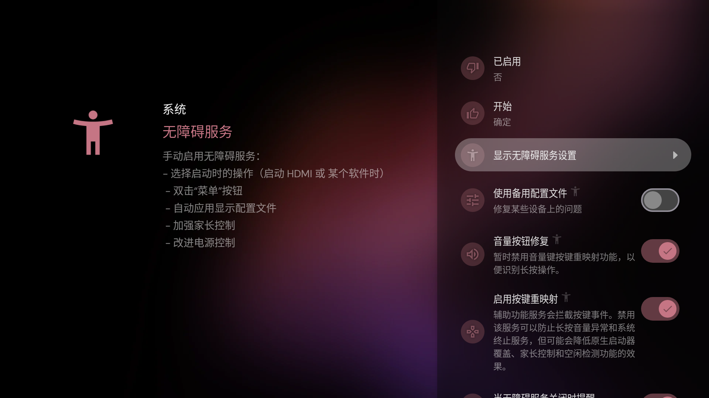
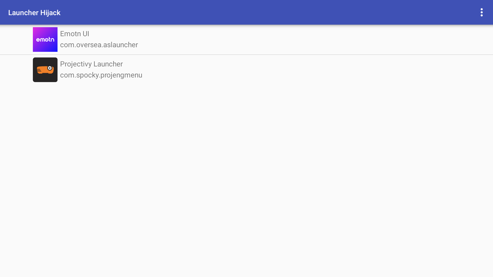
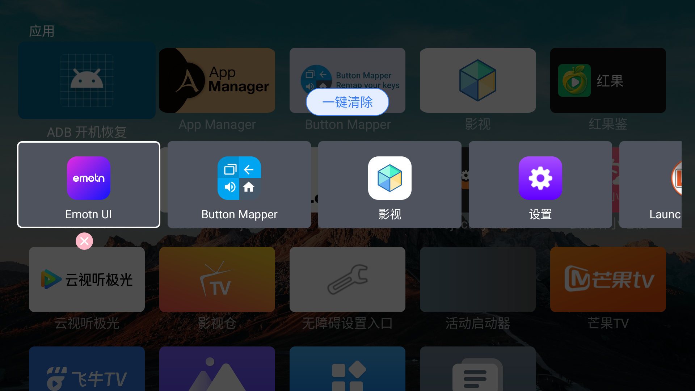

[前一篇](/blog/xiaoming-q5-pro-adb/)已经介绍了小明 Q5 Pro 怎么打开 ADB。这篇接着往下做：连接上电脑以后，怎么换一个顺手的桌面，怎么让 Home 键回到新桌面，以及怎么补上原厂菜单里不容易找到的设置入口。

我用的是 **小明 Q5 Pro（XMM3101），极光 TV 版，Android 13，固件 2.0.7.1070**。以下是这台机器截至 2026 年 10 月 12 日的实测记录，其他型号和固件需要另外验证。

之前参考过杨葛格的[《将 FengOS 系统默认桌面更换为第三方桌面启动器》](https://zhuanlan.zhihu.com/p/19270170689)。原文基于 FengOS 的环境，并明确排除了 Q5 Pro 等极光 TV 机型。我这里补充的是 Q5 Pro 上的具体入口、遇到的问题和实际结果。

## 目前实现了什么？

| 项目 | 目前的结果 |
| --- | --- |
| 电脑通过网络 ADB 连接投影仪 | 已实现，可以安装 APK、打开指定设置页面、读取状态 |
| 关机再开后自动恢复 ADB | 自制工具已通过一次完整关机再开测试；刚开机可能暂时连不上，拔电重启未单独测试 |
| 使用第三方桌面 | Emotn UI 已安装并正常打开；Projectivy 也试过 |
| 按 Home 回 Emotn UI | 最终采用 Launcher Hijack 接管，ADB 按键测试通过；重启后的保持情况未完成验证 |
| 双击 Home 打开多任务 | 最终组合下，ADB 连续 Home 可打开原厂多任务；不是必须靠 Button Mapper 才能实现 |
| 打开无障碍设置 | 已找到原厂入口，并做了一个跳转工具；Projectivy 原来的跳转问题已实测解决 |
| 补充 TV 设置界面 | 旧版移植能打开多个页面，系统提示音开关也验证过能生效 |
| 进入开发者选项 | 授权后可直接用 ADB 打开，检查时开发者模式已开启 |
| 完整的新版原生侧栏设置 | 只做到了部分界面运行，多处仍闪退，暂不作为日常方案 |
| Bootloader 解锁、完整 root、刷机 | 没有完成，不能把前面这些功能叫作“完全解锁” |

这次日常使用的重点是 **Emotn UI＋Launcher Hijack＋原厂无障碍入口**。补充设置和 ADB 自动恢复按需安装，不用把所有工具都装一遍。

## 准备文件，先确认 ADB 能连接

开启 ADB 的菜单操作沿用前一篇，这里不再重复。电脑和投影仪在同一个局域网，连接后用 `adb devices` 确认设备状态是 `device`。

```sh
adb connect 投影仪IP:5555
adb devices
```

把 `投影仪IP` 换成你设备的实际地址。后面的简写命令假设电脑只连接这一台 Android 设备；如果还连接了手机或模拟器，改成 `adb -s 投影仪IP:5555 shell ...` 或 `adb -s 投影仪IP:5555 install ...`。

电脑没有 ADB 的话，可从 [Android 官方 Platform Tools 页面](https://developer.android.com/tools/releases/platform-tools)获取。Windows PowerShell 在工具所在目录运行时，可能需要把 `adb` 写成 `./adb.exe`；macOS/Linux 可使用 `./adb`。命令行使用方式见 [Android 官方 ADB 文档](https://developer.android.com/tools/adb)。

我这次使用的文件如下。版本号记录的是实测版本，不代表必须追最新版本。

| 文件或工具 | 实测版本／用途 | 获取方式 |
| --- | --- | --- |
| Emotn UI | 1.1.0.2，桌面 | [官网](https://app.emotn.com/ui/) |
| Launcher Hijack | 4.0.3，接管 Home 后打开指定桌面 | [作者发布页](https://github.com/BaronKiko/LauncherHijack/releases/tag/403) |
| TvSettingsOnFire | 0.1，旧版 TV 设置移植 | [作者发布页](https://github.com/ewlsh/TvSettingsOnFire/releases/tag/v0.1) |
| 无障碍设置入口 | 本次自制，只跳转至 Q5 的原厂页面 | [q5-accessibility-bridge.apk](/downloads/q5/q5-accessibility-bridge.apk) |
| ADB 开机恢复 | 本次自制，开机后恢复 ADB 开关 | [q5-adb-restore.apk](/downloads/q5/q5-adb-restore.apk) |

后两个是针对本机做的小工具，不是厂商官方软件。源码和校验值打包在[工具合集包](/downloads/q5/q5-tools-with-source.zip)里，也可以单独看 [SHA256SUMS.txt](/downloads/q5/SHA256SUMS.txt)；其中无障碍入口工具不申请权限，ADB 恢复工具需要单独授权。

## 先解决“重启以后 ADB 又关了”

这台 Q5 Pro 在工程菜单打开 ADB 后，关机再开可能又连不上。排查厂商服务代码发现，它在启动时会按一个默认值重新设置 ADB，而本机这个默认值是关闭。

因此，单次打开工程菜单里的开关，不等于每次开机都会保持。

我这次做了一个“ADB 开机恢复”小工具。它收到开机完成广播后，把 ADB 开关恢复为开启，并安排约 30、90、180 秒后的几次复查。实际执行时间可能受系统调度影响。

安装并授权：

```sh
adb install q5-adb-restore.apk
adb shell pm grant local.q5.adbrestore android.permission.WRITE_SECURE_SETTINGS
adb shell am start -n local.q5.adbrestore/.MainActivity
```

界面打开后，点击 **“启用开机恢复并立即恢复 ADB”**。仅安装 APK 不会默认启用自动恢复。

这次完整关机再开后，开机早期连接曾被拒绝，随后自动恢复；日志记录了开机广播将 ADB 从 `0` 改为 `1`，没有再手动进入工程菜单开开关。**一次关机再开已通过，但还没有单独做拔电重启或长期稳定性测试。**

如果刚进入桌面还连不上，先等系统启动完成，再检查投影仪 IP 是否变化。工具只恢复开关，不会替你固定 IP，也不会修改 ADB 端口。

不想自动恢复时，在工具里点“停用自动恢复”，或卸载它。停用和卸载不会立即关闭当前已开启的 ADB，需要关闭时仍可回工程菜单操作。

本机调试日志曾出现不要求连接认证的记录，所以持续开启网络 ADB 时，只在自己可信的局域网使用，不要把 5555 端口映射到公网。

## 无障碍入口打不开，先找到原厂的那个页面

安装 Projectivy 后，我遇到过一个问题：点“显示无障碍服务设置”无法正常进入。后来查到，这台机器的标准 Android 无障碍跳转入口没有正确指向原厂页面，但 CVTE 自己的入口还在。

电脑上执行这条命令即可打开：

```sh
adb shell am start -a com.cvte.intent.action.ACCESSIBILITY_SETTING
```

这一步打开的是 Q5 自带的设置，不需要先安装新版 Google Settings。

如果希望以后直接用遥控器打开，或者解决 Projectivy 的跳转问题，可以安装“无障碍设置入口”：

```sh
adb install q5-accessibility-bridge.apk
```

它只做页面跳转，没有后台服务，也不会自动帮你开启任何无障碍服务。装好后，桌面会出现同名入口；Projectivy 原来的“显示无障碍服务设置”也已由我实际点进去验证过。



图中展示的是 Projectivy 的入口位置；画面中的其他开关不作为本教程要求，不需要照着全部打开。

## 安装 Emotn UI，让 Home 键回到新桌面

先下载 Emotn UI 和 Launcher Hijack。为了方便输入，下面假设把两个 APK 分别重命名为 `emotn-ui.apk` 和 `launcher-hijack.apk`，并在文件所在目录运行命令：

```sh
adb install emotn-ui.apk
adb install launcher-hijack.apk
```

装好后，先手动打开一次 Emotn UI，确认它能正常进入桌面。接着配置 Launcher Hijack：

1. 用上一节的命令或“无障碍设置入口”，打开原厂无障碍页面。
2. 找到 Launcher Hijack 对应服务，可能显示为 **“To detect home button press”**，进入后启用。
3. 打开 Launcher Hijack，在列表里选择 **Emotn UI**，确认选择。
4. 如果看不到 Emotn UI，可在右上角菜单取消 `Launchers Only` 筛选，再检查列表。
5. 打开另一个应用，再按 Home，验证能否回到 Emotn UI。

Launcher Hijack 用无障碍服务检测 Home 动作。这里只开启它需要的服务，不需要把列表里所有服务都开启。



**我最后保留的桌面配置：Launcher Hijack 指向 Emotn UI，停用 Button Mapper 和 Projectivy 的无障碍接管。** 原来已有且与桌面无关的服务可以保留，不要用一条命令覆盖整个无障碍服务列表。

之前试过让 Button Mapper 单独处理 Home，结果又回到了腾讯桌面；恢复 Launcher Hijack 后，ADB 模拟 Home 能回到 Emotn UI。因此这篇先写已经验证过的这一套。

这里实现的是 Home 操作后进入第三方桌面。原厂桌面还在，没有被卸载，系统的 HOME 解析也仍可能指向腾讯桌面。**最终组合的重启后效果尚未完成验证，所以暂时不称为“永久替换默认桌面”。**

## 双击 Home 的多任务还在吗？

在最终的 Launcher Hijack 配置下，ADB 连续发送两个 Home，仍然能打开原厂多任务界面，显示应用卡片和“一键清除”。当时 Button Mapper 已经停用，所以不能把这个结果归功于 Button Mapper 的双击映射。



截图里能看到 Button Mapper 的卡片，只表示它安装过、打开过，不代表拍摄时服务仍在工作。

实体遥控器的双击在前面的测试中成功过；最终组合下保留了 ADB 按键验证记录，遥控器手感和重启后状态仍应在自己的机器上再试一次。不能据此保证所有固件都保留双击功能。

如果遇到 Home 回腾讯，先检查 Launcher Hijack 的目标是否还是 Emotn UI、无障碍服务是否仍启用，再检查有没有其他桌面接管工具同时工作。

## 补上 TV 设置和开发者选项

如果还想要 Android TV 风格的设置页面，我这里试了 [TvSettingsOnFire](https://github.com/ewlsh/TvSettingsOnFire)。它是旧版移植，原本面向 Fire TV；在 Q5 Pro 上只能算补充设置，不是整套 Android 13 原生系统设置。

下载发布页的 `app-release.apk` 后，我把它重命名为 `tvsettings-on-fire-v0.1.apk`，然后安装、授权：

```sh
adb install tvsettings-on-fire-v0.1.apk
adb shell pm grant com.rockon999.android.tv.settings android.permission.WRITE_SECURE_SETTINGS
adb shell pm grant com.rockon999.android.tv.settings android.permission.DUMP
adb shell am start -n com.rockon999.android.tv.settings/.MainSettings
```

两项授权分别用于修改受保护的系统设置、读取系统诊断信息；它们不会赋予完整系统权限，也不会让所有不兼容页面自动变好。包名只对应这个旧版移植包。权限含义可查 [Android 官方权限文档](https://developer.android.com/reference/android/Manifest.permission)。

这版我实际测到的结果是：

| 页面 | 实测情况 |
| --- | --- |
| 声音 | 能打开；关闭系统提示音后确实生效，测试后已恢复 |
| 显示、日期时间、输入法 | 能打开；没有逐项验证修改效果 |
| 无障碍、开发者选项 | 能打开；没有逐项验证全部功能 |
| 语言 | 会因旧接口不兼容而闪退 |
| 应用管理 | 没有正常打开 |

我曾在“关于”里连续点版本号，看到“还差一次”的提示后闪退。后来的处理流程是 **给移植版授权，然后通过 ADB 直接打开开发者选项**：

```sh
adb shell am start -n com.rockon999.android.tv.settings/.system.DeveloperOptionsActivity
```

查看开发者模式开关可以用：

```sh
adb shell settings get global development_settings_enabled
```

我这台检查时返回 `1`，表示已经开启。打开页面的命令本身不等于设置这个开关；也没有证据证明当时“连点版本号闪退”本身被修好了，只是后面可以直接进入页面，不必反复卡在那一步。

安装这个移植版后，部分应用的通用“系统设置”按钮可能会打开它。需要原厂设置时，可以直接执行：

```sh
adb shell am start -n com.cvte.settings/.Settings
```

## 新版侧栏设置和 root，试到了哪里？

后面还试过从 Google Android TV 13 镜像提取 Settings。原包直接安装遇到签名和系统共享身份冲突，经过应用层兼容修改后，右侧栏首页、设备偏好设置、日期时间和键盘页面能显示，但应用、语言、显示声音和无障碍等页面仍有闪退。

所以我最终还是切回了旧版。新版侧栏确实跑出来了，可用性却没达到日常使用要求，这篇不把测试包当作推荐方案。

root 也需要分开说：本机的 `su 0` 能返回 UID 0，但仍受 SELinux 和只读文件系统等限制。本次没有建立可用的系统目录覆盖方案，Bootloader 锁状态也没有确认。**换桌面、补设置入口和恢复 ADB 这几项不需要以完成 root 解锁为前提；它们也不能证明机器已经完整解锁。**

## 不想用了，怎么恢复？

按实际装过的工具逐个处理即可，不需要重置投影仪：

- 想恢复原来的 Home 行为：先在原厂无障碍页面关闭 Launcher Hijack 服务，或卸载 Launcher Hijack。验证 Home 已恢复后，再决定是否删除 Emotn UI。
- 不需要旧版 TV 设置：卸载 `com.rockon999.android.tv.settings`。原 CVTE 设置是另外的包。
- 不需要无障碍跳转工具：卸载 `local.q5.accessibilitybridge`；卸载不会替你关闭之前启用的服务。
- 不需要开机恢复 ADB：在工具里停用，或卸载 `local.q5.adbrestore`。如果还要立即关闭 ADB，再去工程菜单关掉开关。

对应的卸载命令放在这里，**按需选一条执行，不是让你配置完全部运行一遍**：

```sh
adb uninstall com.baronkiko.launcherhijack
adb uninstall com.rockon999.android.tv.settings
adb uninstall local.q5.accessibilitybridge
adb uninstall local.q5.adbrestore
```

目前我会保留 Emotn UI＋Launcher Hijack 的桌面组合，以及已经验证过的 ADB 恢复工具。旧版 TV 设置按需要用；新版侧栏继续留在试验阶段。如果同型号用户试过其他固件，欢迎到 [GitHub Issues](https://github.com/luoxu1314/luoxu1314.github.io/issues) 补充固件版本、关机再开后的 Home 表现和双击多任务情况。
